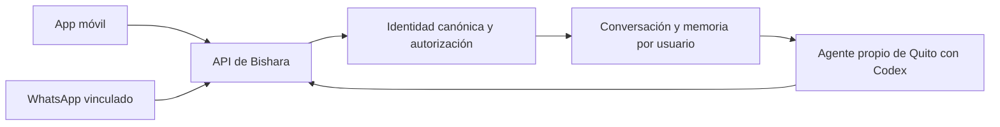

# SOL móvil: Mi espacio

Actualizado el 23 de octubre de 2026. Dirección pedida expresamente por Amaru en esta sesión; implementación en `amaru/mobile-expo`, PR [#13](https://github.com/cbishara/SolsetsHack/pull/13). Este documento comunica el trabajo del carril de Amaru; no declara un consenso de los tres sobre los ADR del producto.

## Referencia elegida

Amaru confirmó **«Mi espacio /demo: interfaz clara, azul y amarillo lima, asistente, pendientes y memoria»** de la rama `codex/sol-desconexion-whatsapp`. La fuente es `web/src/Dashboard.jsx`, `web/src/SolAssistant.jsx`, `web/src/dashboard.css` y `web/src/sol-assistant.css` de esa rama. Para ver el caso correcto: `/demo?caso=personal`.

La interpretación nocturna Ocaso que aparecía en la app fue rechazada. Esta revisión reemplaza su portada y navegación por Mi espacio. Las imágenes Ocaso de Quito quedan como antecedentes, no como guía de esta entrega. El código útil de conexión y almacenamiento se conserva; se reconstruye la capa visual en React Native.

## Qué debe entender una persona al abrir

«Puedo dejar aquí lo que ocupa mi cabeza, encontrar un paso pequeño y retomar después sin explicarlo todo otra vez».

La app debe ayudar a ordenar y reducir esfuerzo, con un tono cercano y sobrio. No promete eliminar ansiedad, curar problemas de sueño ni actuar en servicios ajenos cuando solo preparó una propuesta. El progreso visible debe corresponder a datos guardados, nunca a porcentajes inventados.

## Mapa de pantallas

| Destino | Pregunta que resuelve | Acción principal | Estado que debe persistir |
| --- | --- | --- | --- |
| Mi espacio | ¿Por dónde empiezo hoy? | Hablar con SOL / dejar un pendiente | Pendiente actual y contexto disponible |
| SOL | ¿Qué puedo hacer con esto que tengo en la cabeza? | Escribir → recibir respuesta → elegir un paso | Borrador, conversación, envío pendiente y su identificador |
| Pendientes | ¿Qué dejé preparado? | Revisar el siguiente paso y retomarlo | Pendientes guardados localmente; no afirmar sincronización inexistente |
| Memoria | ¿Qué sabe SOL de mí? | Ver, corregir y borrar lo declarado | Preferencias, horarios y rutinas con fuente visible |
| Ajustes, secundario | ¿A qué está conectado y qué controlo? | Conectar testing, desconectar, revisar estado | Acceso seguro y origen de los datos |

Las pestañas son destinos, no pasos de un formulario. El chat conserva su borrador al navegar. Los detalles o ajustes se cierran con una acción clara de volver. Cada pantalla tiene una acción dominante, áreas táctiles de al menos 44 puntos y texto que puede crecer.

## Sistema visual

| Rol | Valor | Regla |
| --- | --- | --- |
| Acción / selección | `#2e59e5` azul SOL | Texto blanco en botón azul; texto azul sobre blanco |
| Acento | `#e4f51a` amarillo lima | Fondo de una acción o detalle; siempre texto oscuro |
| Superficie | `#ffffff` | Espacio claro y agrupación con separación discreta |
| Tinta | Azul casi negro de la referencia | Títulos, lectura y texto sobre lima |
| Secundario | Gris con contraste suficiente | No copiar el texto diminuto del prototipo web |

Conservar el gesto gráfico de SOL y las flechas de la referencia, sin convertir decoración en una barrera para escribir. Tipografía de sistema en iOS; cuerpo cercano a 17 pt, secundario a 15 pt, notas a 12–13 pt. Espaciado consistente en múltiplos de 4, radios suaves y botones con estados pulsado, deshabilitado y ocupado. El lima sobre blanco tiene contraste insuficiente: no usarlo como texto ni como único indicador.

## Flujos y límites

1. **Empezar:** abrir Mi espacio → escribir una preocupación o pendiente ficticio → SOL propone un paso concreto. Si falta contexto, hace como máximo una pregunta útil.
2. **Reducir esfuerzo:** «Estoy cansado, dame algo de dos minutos» → conservar la preferencia declarada → adaptar la siguiente propuesta. Esto es contexto recuperado, no entrenamiento de pesos.
3. **Corregir:** «Ahora termino a las 19:00» → sustituir el horario anterior en memoria → comprobarlo al volver. No acumular hechos contradictorios.
4. **Retomar:** salir del chat o cerrar la app → recuperar borrador/contexto → continuar. Si una petición quedó sin confirmación, reintentar con el mismo UUID; no crear otra inferencia por accidente.
5. **Borrar:** revisar alcance → confirmar → borrar el contexto correspondiente. No anunciar que se borró un servidor si falló la conexión.
6. **Conectar:** los ejemplos locales se identifican como tales. Con backend, mostrar respuesta y estado reales. Sin OAuth/modelo disponible, mostrar fallo y conservar el texto; no simular IA.

Prioridad confirmada por Amaru: **responder y aprender primero; recordatorios después**. La primera memoria incluye preferencias, horarios y rutinas que el usuario declare. WhatsApp permanece pendiente de integración; la app no debe presentar ese canal como conectado sin evidencia.

## Un asistente, dos canales

La arquitectura objetivo comparte conversación y memoria entre app y WhatsApp **solo después de vincular de forma verificada ambos accesos**. No asociar cuentas por un nombre o por un teléfono que alguien escribió. El piloto actual usa `demo:web`, una conversación de testing compartida; no cumple todavía esa vinculación. Nunca responder a terceros haciéndose pasar por el usuario.

## Reparto y comunicación

- **Amaru, local:** pantallas, componentes, navegación, accesibilidad y cliente móvil. Un agente reconstruye la UI, otro revisa el cliente y otro instaló/revisó las diez skills. La sesión coordinadora revisa y publica documentación.
- **Quito:** comportamiento, contexto, evaluaciones y cuenta de inferencia, pedidos en [#14](https://github.com/cbishara/SolsetsHack/issues/14) y [#8](https://github.com/cbishara/SolsetsHack/issues/8). No se le delega diseño.
- **Bishara:** contrato, identidad, persistencia, autenticación, conexión WhatsApp y entorno de testing; actualizado [#7](https://github.com/cbishara/SolsetsHack/issues/7).

Un issue asignado comunica el trabajo; no implica que la sesión privada del otro agente ya lo esté ejecutando. La respuesta/PR de cada dueño es la evidencia de avance.

## Criterios de revisión

- Comparar las nuevas pantallas con Mi espacio, no con Ocaso.
- Comprobar a 320, 390 y 430 puntos: texto largo, navegación, scroll y acciones accesibles. En iPhone: teclado, Dynamic Type y VoiceOver requieren prueba física o simulador; una captura web no los demuestra.
- Chat: carga inicial, vacío, contenido, error, reintento y reconexión distinguibles; borrador conservado.
- Memoria/pendientes: lectura, corrección, borrado y persistencia coherentes con su almacenamiento real.
- TypeScript, pruebas relevantes y exportación Expo verdes. Registrar por separado la inferencia real y WhatsApp; ninguna se da por aprobada por pasar tests con mocks.

Estado de implementación y comprobaciones: [MOBILE.md](MOBILE.md). Fuentes y aplicación de las diez skills: [SKILLS_MOBILE.md](SKILLS_MOBILE.md).

## Novedades de coordinación al cerrar

Quito recibió #14 y propuso Codex CLI/SDK con su cuenta, sin Hermes por ahora (#8). Amaru confirmó seguir con ese agente y la cuenta de Quito; Hermes puede venir después. La dirección está confirmada para esta entrega. Las capacidades del chat y la identidad compartida aún necesitan contrato/prueba. El PR #16 reporta el intercambio de carriles; la UI que Amaru pidió durante esta sesión se entrega terminada y revisable en #13 para evitar reconstrucciones paralelas. El diseño confirmado Mi espacio sigue siendo la fuente de esta entrega.
