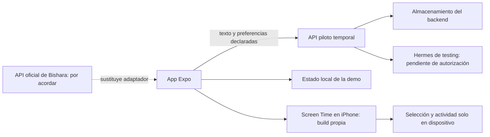

# Plan móvil de Amaru y coordinación

23 de octubre de 2026. Rama `amaru/mobile-expo`. Este documento registra una implementación experimental y las preguntas pendientes; **no convierte propuestas en ADR oficiales**.

## Documentación leída

PR [#5](https://github.com/cbishara/SolsetsHack/pull/5), ya integrado en main: `CLAUDE.md`, reparto, protocolo `tools/tarea` y ADR oficiales de producto, Expo, cinco funcionalidades, prototipo de referencia y no responder por Rodrigo. También el ADR pendiente de bloqueo Opal, la propuesta de onboarding nocturno del [PR #12](https://github.com/cbishara/SolsetsHack/pull/12) y la documentación local de SOL/Hermes.

Diferencia reconocida: el equipo centra la demo oficial en la guardia de Rodrigo y propone `server/` + `agent/` nuevos; Amaru pidió probar móvil, contexto y bloqueo, y otra sesión local desarrolla Hermes en el piloto existente. La app mantiene esa distinción. No se han editado otros carriles ni cambiado main.

## Comunicación comprobada

- Quito: [#6](https://github.com/cbishara/SolsetsHack/issues/6), plan completo y solicitud de opinión, asignado a `Quitogonzalez`. Enviado; al último chequeo no había respuesta.
- Bishara: [#7](https://github.com/cbishara/SolsetsHack/issues/7), contrato API, identidad, persistencia, alertas y URL de testing. Enviado; al último chequeo no había respuesta.
- Sesión local «Revisa documentación y desarrolla»: comunicación directa entre hilos de Codex, **recepción y respuesta confirmadas**. Es dueña del piloto Hermes; no toca `mobile/`. Confirmó contrato y limitaciones. La app no ejecuta su verificador de consumo.
- Esa sesión solicitó OAuth y modelo de la cuenta de Quito en [#8](https://github.com/cbishara/SolsetsHack/issues/8). No se usó ninguna cuenta personal de Amaru.

Los agentes remotos reciben las tareas al revisar el protocolo GitHub. Enviar/asignar un issue no prueba que Quito ya lo leyó ni que aprobó el plan. No hay un canal de chat directo con su sesión privada.

Recibida de Quito la [tarea #10](https://github.com/cbishara/SolsetsHack/issues/10): actualizar main, comprobar gh y leer las reglas. Se atiende dentro de la solicitud de Amaru. La rama móvil se actualiza sobre main; el checkout compartido del piloto Hermes no se cambia de rama ni se mezcla.

## Recorrido implementado

`mobile/` en Expo SDK 58, React Native y TypeScript, compatible con el SDK que Amaru confirmó. Pantallas: Mi noche, SOL, Mi ritmo, Ajustes. Dirección visual nocturna inspirada en las referencias Ocaso del carril de Quito.

- Noche: contrato de guardia local y modo sombra explícito.
- SOL: descarga de pendientes, memoria declarada visible, corrección y borrado; reglas locales para probar sin claves o adaptador al chat real del piloto.
- Mi ritmo: ejemplos ficticios, «Lo vi», feedback y métricas de lo revisado. No se activa modo real desde datos simulados.
- Ajustes: origen de testing, contraseña en SecureStore, conexión comprobada y separación de almacenamiento local/servidor.
- Experimento iOS: selección de apps, permiso individual, bloqueo programado y observación local por umbral. Necesita una build propia y prueba física; no funciona en Expo Go.

## Qué se puede afirmar y qué falta

| Etapa | Evidencia / pendiente |
| --- | --- |
| Coordinación | Sesión Hermes respondió. Quito y Bishara tienen tareas; opinión y contrato oficial pendientes. |
| Diseño Expo Go | Proyecto implementado y bundles para iOS/Android/web. Falta confirmación de apertura en el iPhone de Amaru. |
| Persistencia | Pruebas locales de adaptación, deduplicación y reinicio del backend del piloto con archivos. PostgreSQL/entorno de testing sin verificar. |
| Native build | Configuración y extensiones preparadas. Compilación, firma, instalación y entitlement de distribución pendientes. |
| Bloqueo y actividad | Código de experimento local. No afirmar bloqueo comprobado hasta probarlo en un teléfono. |
| Adaptación | Preferencias explícitas y feedback en la demo. Sin inferencias psicológicas ni endurecimiento autónomo del bloqueo. |
| Alertas, llamada, turnos | Siguen perteneciendo a Bishara/Quito; los ejemplos móviles no son integración real. |

## Próximo acuerdo con Quito y Bishara

1. Revisar #6 y confirmar si el experimento Screen Time permanece separado de la entrega de guardia.
2. Definir contrato versionado de `server/`: identidad, noche, alertas, reconocimiento, feedback, chat y errores. El cliente provisional `src/api.ts` no es ese contrato oficial.
3. Proporcionar un entorno HTTPS de testing con persistencia y acceso del equipo por canal privado. Probar desde iPhone guardar → cerrar → reabrir → leer.
4. Quito autoriza su cuenta en Hermes y verifica el proveedor/modelo de una inferencia real, según #8.
5. Confirmar Apple Developer, Team ID y bundle ID. Amaru respondió «No / no lo sé» sobre la membresía; no se compró ni configuró una.

Guía ejecutable y criterios de prueba en [mobile/README.md](../../../mobile/README.md).

## Validación realizada

- TypeScript y 7 pruebas móviles pasan.
- Bundles JavaScript exportados para iOS, Android y web con SDK 58.
- Adaptador contra HTTP real del piloto en proceso aislado: escritura, deduplicación, reinicio y recuperación del contexto pasan; almacenamiento de archivos, sin servicios externos.
- Interfaz inspeccionada en Safari: navegación, conversación, preferencia por dos minutos y persistencia tras recargar. No equivale a prueba física en iOS.
- Prebuild iOS genera app y las tres extensiones con entitlements. Sin compilación Swift ni firma.
- Expo Doctor: 19/20 comprobaciones; pendiente CocoaPods/toolchain local. Se puede usar EAS para compilar cuando se configure la cuenta del equipo.
- Auditoría de dependencias con avisos transitivos aún abiertos, detallados en el README móvil. No se declara lista para distribución.
