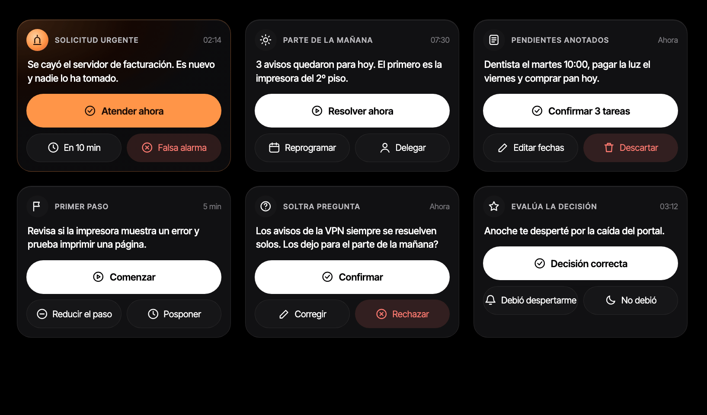

# Tarjetas de solicitud con botones que respiran

Propuesta de Quito para Bishara, 2026-10-24. Es una maqueta en HTML, no código de `mobile/`.

Cada mensaje de Soltra que pide una respuesta se muestra como una tarjeta de solicitud. Arriba van el tipo y la hora. Abajo, una acción principal a todo el ancho y dos secundarias más chicas. El modelo viene de Better Stack On-call y Uber Driver: una tarjeta con un botón grande para aceptar, que se entiende medio dormido.

Los seis tipos de mensaje son la alerta de noche, el parte de la mañana, los pendientes anotados, el primer paso, la pregunta de Soltra y la evaluación de la decisión. Los nombres de los botones están en `maqueta.html`.

Las reglas son cuatro. El botón principal es blanco, como pide el sistema Soltra negro (`mobile/src/theme/tokens.ts`). Solo la alerta urgente usa la luz de Sol: tarjeta teñida de ámbar y botón `#FF9548`. El rojo `urgent` queda solo para descartar. El botón principal "respira" con un halo ámbar cada 2,8 s, y la animación se apaga con "Reducir movimiento".

Pendiente: "Debió despertarme" queda justo en su botón; se puede acortar.

Para verla: abrir `maqueta.html` en el navegador.
