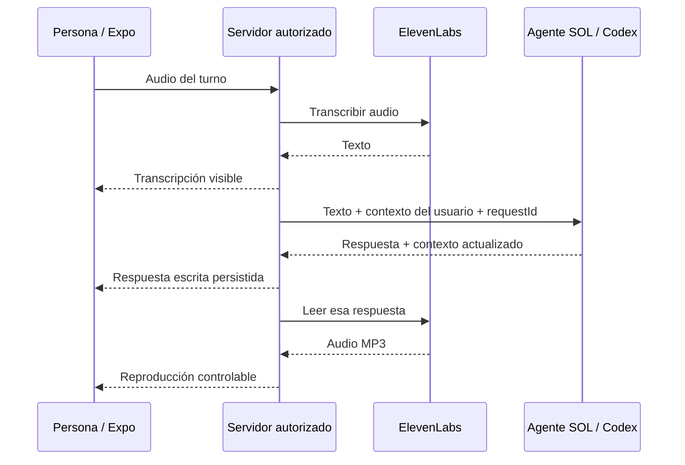

# PRD / spec: configurar SOL, conversar y usar voz

Fecha: 2026-10-23. Responsable: Quito, `agent/`.
Estado: borrador solicitado por Quito; pedido de implementación autorizado, categoría de ADR pendiente. No certifica entrega móvil ni despliegue.

> Actualización 2026-10-24: la app ahora se llama Soltra y su agente es Sol. La app ya graba con `expo-audio` y llama a `POST /api/transcribe`, que todavía no existe en `server/`. El adaptador y el contrato propuesto para el servidor están en [`agent/VOICE.md`](../../../../agent/VOICE.md). Lo que sigue es el registro del 2026-10-23.

## 1. Problema y resultado

Quito necesita un lugar claro para configurar el agente, probar sus casos y corregir su comportamiento. Al abrir la app quiere conversar con SOL, sin resolver direcciones técnicas antes de empezar. Pide que SOL entienda lo que cuenta y que también pueda proponer; para la primera versión quiere hablarle y escuchar su respuesta con ElevenLabs.

Resultado esperado: una conversación breve en la que SOL demuestra qué entendió, pregunta cuando hace falta y propone ayuda concreta cuando tiene contexto suficiente. El mismo historial y la misma memoria sirven para texto y voz. No se promete eficacia clínica ni que un pendiente se haya resuelto por haberlo anotado.

## 2. Qué se pidió y qué sigue abierto

| Tema | Estado |
| --- | --- |
| Trabajar el cerebro, configuración, casos y pruebas en `agent/` | Pedido de Quito, compatible con el carril existente |
| Entender y también poder proponer | Pedido explícito de Quito |
| Entrada y respuesta habladas | Elegido por Quito en esta conversación |
| ElevenLabs como proveedor de voz | Elegido por Quito; cuenta autorizada, Miguel G elegido y STT/TTS reales verificados desde el Mac |
| Codex como motor del agente propio | [ADR oficial](../../adr/oficiales/2026-10-23-agente-propio-con-codex.md) |
| Micrófono, reproducción y conexión sin URL manual en la app | Dependencia de Bishara, dueño de `mobile/`; no implementada aquí |
| Contrato de transporte, autenticación y despliegue compartidos | Dependencia de Amaru y acuerdo entre los tres |
| Conversación manos libres, círculo reactivo, interrupción y micrófono silenciable | Nuevo pedido explícito de Quito; maqueta local para revisar juntos. La integración móvil y la detección del fin del turno siguen pendientes |
| Categoría oficial o por confirmar del nuevo acuerdo | Pendiente; [registro](../../adr/por-confirmar/2026-10-23-sol-conversacion-y-voz.md) |

El tono sigue bajo la coordinación de Amaru; Quito edita el prompt, según el [ADR publicado en main](https://github.com/cbishara/SolsetsHack/blob/f78a985/docs/equipo/adr/oficiales/2026-10-23-quien-edita-el-prompt.md). Este cambio conserva el tono existente.

## 3. Dónde se trabaja

| Lugar | Uso |
| --- | --- |
| Conversación de Quito con su agente de desarrollo | Definir y revisar un comportamiento o caso a la vez |
| `agent/criteria/chat.md` | Instrucciones editables: entender, preguntar, proponer, límites y memoria |
| `agent/src/chat.ts` | Construcción del contexto, validación, conversación y persistencia |
| `agent/cases/conversacion-voz.json` | Casos sintéticos propuestos para revisar. No equivalen a veredictos de Quito |
| `agent/criteria/common.md` y `agent/cases/semana-simulada.json` | Clasificación nocturna existente, distinta de las pruebas del chat |
| `agent/src/voice/elevenlabs.ts` | Adaptador servidor de voz: transcribir y leer la respuesta exacta de SOL |
| Expo, app de Bishara | Hablar, escribir, escuchar y comprobar la experiencia real |

El criterio conversacional se lee al construir cada prompt; editarlo afecta la siguiente inferencia del código actualizado. Para incorporar cambios en TypeScript a un proceso ya iniciado hay que reiniciarlo o usar `npm run dev`. Las pruebas se hacen con datos sintéticos y un almacén aislado.

## 4. Requisitos de conversación

| ID | Requisito observable |
| --- | --- |
| CONV-01 | Ante un mensaje ambiguo, SOL recoge lo entendido y hace como máximo una pregunta útil; no inventa un pendiente ni una fecha. |
| CONV-02 | Con contexto suficiente, puede proponer un paso concreto sin pedir permiso de trámite para cada sugerencia. |
| CONV-03 | Si la persona pide solo ser escuchada, no impone tareas ni un plan. |
| CONV-04 | Si la propuesta no sirve, utiliza la corrección para cambiar su ayuda; no repite el mismo consejo. |
| CONV-05 | No vuelve a preguntar datos vigentes presentes en memoria. Conserva el contexto relevante. |
| CONV-06 | Sus respuestas son breves y fáciles de escuchar: una idea y como máximo una pregunta por turno. |
| CONV-07 | Distingue propuesta de ejecución: no afirma que llamó, compró, agendó o avisará sin una capacidad verificada. |

Ejemplo ambiguo: «Tengo muchas cosas dando vueltas» → SOL pregunta qué preocupa más. Ejemplo concreto: «Mañana debo llamar al taller; tengo el número y prefiero pasos de dos minutos» → puede proponer preparar la pregunta para esa llamada. Son ejemplos de aceptación propuestos; no guiones rígidos.

## 5. Memoria y aprendizaje

MEM-01: guardar solo datos, preferencias estables o reglas declarados por quien conversa, con evidencia literal del mensaje actual. Una hipótesis, una cita sobre otra persona o una sugerencia de SOL no se transforma en un hecho del usuario. Las preferencias temporales («por ahora»), el cansancio del día y las tareas puntuales quedan en conversación/pendiente, salvo petición explícita de recordarlos.

MEM-02: corregir la misma clave y dejar de usar el valor anterior. Ejemplo sintético: fin de turno 18:00 → corrección 19:00 → reabrir y recuperar 19:00.

MEM-03: mantener el alcance real de los controles del piloto: `MEMORIA` consulta; `NUEVO` cambia el pendiente conservando recuerdos; `BORRAR` borra la conversación y lo aprendido desde ese chat, conservando onboarding y feedback. No borra registros del proveedor ni de WhatsApp.

MEM-04: texto y voz confirmados alimentan el mismo cerebro y usuario autorizado. El piloto `demo:web` sigue siendo compartido por el equipo; no es una cuenta multiusuario ni prueba vinculación con WhatsApp.

Aprender significa ajustar instrucciones, ejemplos y memoria. No se afirma entrenamiento de los pesos de Codex. Un caso guardado para evaluación no se incorpora automáticamente al prompt. En clasificación, el feedback almacenado sí se incorpora como ejemplo; en chat aún no existe una valoración general de respuestas integrada con el móvil.

## 6. Requisitos de voz con ElevenLabs

| ID | Requisito observable |
| --- | --- |
| VOZ-01 | La persona toca para entrar a voz y autoriza el micrófono si hace falta; después conversa sin mantener pulsado ni iniciar cada turno manualmente. Puede silenciar o terminar. El chat escrito sigue disponible si rechaza el micrófono. |
| VOZ-02 | El audio se transcribe con ElevenLabs y su texto es visible y corregible. Un fallo o silencio no crea texto inventado ni una memoria. |
| VOZ-03 | El texto pasa por el mismo `createChat`; la respuesta y memoria no dependen de un segundo agente de voz. |
| VOZ-04 | ElevenLabs lee el texto de la respuesta guardada de SOL; no inventa una respuesta adicional. |
| VOZ-05 | Si falla la lectura, la respuesta escrita permanece y puede volver a escucharse sin volver a ejecutar Codex. |
| VOZ-06 | Captura, transcripción, respuesta y reproducción tienen estados diferenciados. No mostrar éxito por un HTTP 200 si el motor devolvió `unavailable`. |
| VOZ-07 | La clave vive en el servidor o Mac, nunca en `EXPO_PUBLIC_*`, el bundle, un issue ni el repositorio. |
| VOZ-08 | No hacer reintentos automáticos con consumo incierto de audio o modelo; distinguir reanudar reproducción de repetir la inferencia. |
| VOZ-09 | Botón circular central en la barra inferior que abre la conversación de voz. La maqueta amplía el pedido previo a Bishara; se revisa con Quito antes de integrar en el carril móvil. |
| VOZ-10 | El círculo responde a la intensidad real de la voz de la persona y de la respuesta de SOL; el estado de espera es distinto. Silenciado permanece quieto. Respetar la preferencia de reducir movimiento; no implica vibración continua del teléfono. |
| VOZ-11 | Si la persona habla mientras SOL responde, detener el audio y priorizar su nuevo turno. Tocar el círculo también interrumpe. Una respuesta atrasada no vuelve a reproducirse tras la interrupción; no repetir la inferencia anterior. |
| VOZ-12 | Silenciar desactiva la entrada sin terminar la conversación ni necesariamente cortar lo que SOL ya dice. «Ver texto» conserva el mismo hilo. «Terminar» y volver al chat cierran captura y reproducción. |

### Primera maqueta de conversación manos libres

Quito amplió el pedido: quiere diseñar aquí la experiencia, verla durante la revisión y usar patrones familiares como los de ChatGPT: círculo que reacciona a la voz, poder hablar por encima de SOL para interrumpirlo y micrófono silenciable. Es un pedido concreto de comportamiento; la primera dirección visual sigue pendiente de su revisión.

La [maqueta interactiva y su explicación](../diseno/voz-sol/README.md) incluye entrada central desde el chat, conversación en pantalla completa, tres controles estables —silenciar, ver texto y terminar—, modo noche/día, respuesta de Miguel G, espera y error. No cambia el sistema visual oficial Mi espacio. El texto del diseño usa ejemplos sintéticos.

Revisión visual 02 pedida por Quito: conservar la dirección azul/oscura, dando más vida a la voz y evitando el acabado plano. La maqueta usa el componente Orb de ElevenLabs UI adaptado con una superficie fluida de SOL, Three.js/React Three Fiber, transiciones con Motion e iconos Phosphor Duotone. El fondo nocturno añade bruma, horizonte y puntos de luz discretos, con una base translúcida para los controles. La fuente, versiones y licencias se mantienen junto al diseño. Son dependencias del prototipo web, sin cambios en mobile/; el componente DOM/WebGL requiere acordar su implementación nativa con Bishara. La aprobación final de esta revisión sigue pendiente.

El navegador puede medir voluntariamente el micrófono para mover el círculo, sin grabar ni enviar audio. También puede detener la muestra de Miguel al detectar voz. Esto verifica la interacción local del prototipo; no acredita transcripción, una respuesta del agente ni comportamiento de interrupción en Expo. La animación de los estados de ejemplo se identifica como demostración fuera de la pantalla del producto.

Este pedido reemplaza el alcance de grabar y enviar cada turno manualmente como experiencia objetivo. El adaptador de ElevenLabs sigue trabajando por llamadas completas: identificar turnos, controlar eco, cancelar reproducción y descartar respuestas atrasadas son trabajo pendiente de integración.

### Pedido de diseño para el botón de voz

Quito pidió expresamente una experiencia de voz bonita con un botón circular en el centro del footer del teléfono. Confirmó que el destinatario es Cristóbal Bishara. El pedido se envió en [#28, comentario de diseño](https://github.com/cbishara/SolsetsHack/issues/28#issuecomment-6376805737). La ubicación central solicitada cambia la referencia de botón abajo a la derecha del brief anterior; corresponde a Bishara resolver y acordar el diseño móvil.

Intención: poder hablar con una mano, entender cuándo el micrófono está activo y escuchar a SOL sin configurar direcciones técnicas. Conservar el sistema Mi espacio y su modo noche. La voz elegida y validada por Quito es Miguel G.

| Estado | Comportamiento propuesto para diseñar |
| --- | --- |
| Listo | Botón circular central con nombre accesible «Hablar con SOL». Un toque abre la conversación; permiso de micrófono solo cuando haga falta. |
| Escuchando | Círculo reactivo al volumen real; hablar sin mantener pulsado. El fin del turno debe detectarse y probarse. Silenciar y terminar siempre visibles. |
| Procesando | Mostrar transcripción/espera de SOL, con indicador sobrio; no simular ondas de escucha cuando el micrófono ya está detenido. |
| Respondiendo | Reproducir con Miguel G, conservar texto visible y permitir interrumpir al hablar o tocar el círculo, sin repetir inferencia. |
| Silenciado | Entrada apagada, círculo quieto e indicador textual. Se puede activar de nuevo, consultar el texto o terminar. No se usa la voz para interrumpir mientras el micrófono esté apagado. |
| Error o permiso rechazado | Explicar el problema y mantener la posibilidad de escribir y recuperar el resultado ya guardado. |

Propuesta visual para que Bishara refine: círculo de 64–72 pt, micrófono legible y relieve discreto, con colores de Mi espacio; brillo contenido en modo noche. Es una acción, no una pestaña. Respetar el área segura, el teclado, reducir movimiento y los nombres accesibles; el color no debe ser la única señal de estado. El resto de la navegación queda a su criterio dentro del brief acordado.

El comentario original de #28 corresponde al primer pedido. Ya existe una maqueta local para revisar el alcance ampliado, con interrupción y manos libres; todavía no está integrada en la app. La captura y reproducción reales se prueban en un teléfono con el transporte de #29.

Recorrido de servicios por cada turno detectado en la conversación manos libres:

Si aparece una nueva voz de la persona durante la espera o la reproducción, el cliente detiene el audio anterior y prioriza la nueva entrada; el transporte debe identificar y descartar resultados atrasados. Esa coordinación no está construida por mostrar este diagrama.

No se fija una URL pública nueva desde este documento: el transporte requiere acuerdo con los dueños del servidor y del móvil. ElevenLabs provee STT/TTS; el adaptador no crea un agente conversacional suyo.

## 7. Frontera técnica implementable

El adaptador local expone `transcribe(audio, mimeType, signal?)`, `speak(text, signal?)` y `listVoices(signal?)`. Usa `POST /v1/speech-to-text`, `POST /v1/text-to-speech/{voice_id}` y `GET /v2/voices` del proveedor. No tiene rutas móviles ni identidad propias.

Valores iniciales ajustables: `scribe_v2` para transcripción en español, `eleven_multilingual_v2` para síntesis, MP3 `mp3_44100_128`, plazo 30 segundos por llamada al proveedor. Quito eligió Miguel G (`k8cFOyAg7B9qwBlDDNTC`), configurado localmente mediante `ELEVENLABS_VOICE_ID`. No se selecciona ni clona una voz automáticamente.

Límites locales de implementación: audio de hasta 5 MiB y texto de hasta 2000 caracteres, compatible con el chat existente. Los bytes no acreditan una duración concreta. Se propone grabación breve, pero la duración y el control deben definirse y verificarse en móvil. Las respuestas de audio también tienen un tope de 5 MiB.

Las llamadas no persisten audio en el adaptador. ElevenLabs recibe el audio y el texto a sintetizar: no se promete retención cero del proveedor. La prueba manual opcional sí puede guardar su audio sintético en `.context/`. No se envía a TTS toda la memoria ni el historial.

## 8. Casos y evaluación

El [conjunto de casos](../../../../agent/cases/conversacion-voz.json) cubre: ambigüedad, solo escuchar, propuesta concreta, cansancio declarado, corrección de propuesta, memoria corregida, hipótesis, borrado, petición de acción externa, transcripción fallida, fallo de reproducción y reintento. Todos parten como propuestos; Quito revisa uno a la vez.

Para cada caso se conserva entrada, contexto, conducta esperada, respuesta obtenida y evaluación. Separar evaluación semántica humana de comprobaciones técnicas. Contar la persistencia correcta no demuestra que una propuesta sea útil. Probar variantes de cada caso y reservar casos sin usar para ajustar instrucciones.

Ciclo: elegir caso → ejecutar con datos aislados → Quito evalúa → registrar motivo → cambiar criterio o ejemplo si corresponde → repetir el caso y los anteriores. No generalizar una preferencia de un usuario a todos.

## 9. Aceptación y evidencia

1. Chat: un mensaje ambiguo produce una pregunta útil y ningún plan inventado; un mensaje concreto admite una propuesta; pedir solo escucha no fuerza una acción.
2. Memoria: declarar, corregir y recuperar tras reinicio; otro usuario no recibe esos recuerdos; borrar respeta el alcance documentado.
3. Adaptador: multipart y autenticación correctos; MP3 de la respuesta exacta; errores, cuota, cancelación y plazo visibles; ninguna clave en errores; sin reintento automático.
4. Proveedor real: con clave y voz elegida, sintetizar una frase ficticia y transcribirla; registrar tiempos y revisar fidelidad. Esta prueba no acredita micrófono ni app.
5. Teléfono físico: entrar con un toque, hablar sin mantener pulsado, recibir texto y escuchar la misma respuesta; interrumpir hablando y tocando el círculo; silenciar sin terminar; cerrar sin dejar el micrófono activo; probar altavoz, audífonos, eco y ruido; corregir y recuperar al reabrir; negar micrófono; cortar red; descartar respuestas atrasadas y reintentar sin duplicar.

Disponibilidad a la fecha: chat local y memoria existentes; instrucciones nuevas y adaptador en la rama de trabajo. No están habilitados el micrófono de SOL, el transporte compartido ni la reproducción en el teléfono. La credencial de ElevenLabs quedó guardada localmente y su catálogo real de 31 voces fue consultado. Quito eligió Miguel G; la síntesis real tardó 1989 ms y el recorrido síntesis→transcripción tardó 5350 ms, recuperando la frase sintética salvo puntuación final. La calidad percibida y el uso desde SOL en teléfono todavía deben revisarse. La prueba previa de Codex midió 22–24 segundos por respuesta; añadir voz no permite prometer conversación instantánea.

Comprobación del criterio nuevo: cinco inferencias sintéticas con Codex real. En la primera tanda se observaron aclaración sin plan, escucha sin propuesta y propuesta concreta; también se observó que el modelo guardaba una preferencia temporal y una tarea como recuerdos. Se ajustó el criterio de memoria y se repitieron esos dos casos: permanecieron en conversación/pendiente, sin memoria duradera. Son muestras locales, no una tasa de calidad general ni aprobación de los casos por Quito. TypeScript, las 73 pruebas actuales y la evaluación existente con reglas pasan; nueve pruebas corresponden al adaptador de voz con proveedor controlado. El piloto de la app se reinició con el código actualizado y recuperó la sesión sin cambios.

## 10. Entregas por carril

| Responsable | Entrega |
| --- | --- |
| Quito | Criterio conversacional, casos, adaptador ElevenLabs, pruebas y guía de uso/configuración. |
| Bishara | Captura, controles y reproducción; conexión preparada para que la persona entre al chat sin copiar una URL. Mantener el sistema visual Mi espacio acordado. |
| Amaru | Acceso autenticado, transporte de audio, configuración de secretos y coordinación de identidad/persistencia. |
| Los tres | Acordar el contrato y demostrar el recorrido en dispositivo. |

La entrada por audio figura también en el [brief publicado por Bishara](https://github.com/cbishara/SolsetsHack/blob/f78a985/docs/equipo/bishara/BRIEF_APP.md). Este PRD concreta el pedido de Quito sin dar por construidas las demás capacidades de ese brief.

Coordinación enviada mediante el protocolo del equipo: [móvil, #28](https://github.com/cbishara/SolsetsHack/issues/28) y [transporte de voz, #29](https://github.com/cbishara/SolsetsHack/issues/29). El diseño de manos libres se está revisando localmente con Quito; todavía no se publicó su fuente ni se envió como un diseño aprobado. Las tareas señalan que los archivos del agente siguen locales, pendientes de publicación autorizada.

## 11. Fuentes y límites de comprobación

- [ElevenLabs: transcripción](https://elevenlabs.io/docs/api-reference/speech-to-text/convert), [síntesis](https://elevenlabs.io/docs/api-reference/text-to-speech/convert) y [OpenAPI](https://api.elevenlabs.io/openapi.json): documentación consultada el 2026-10-23. Modelos y permisos de la cuenta deben probarse con su credencial.
- [Expo Audio](https://docs.expo.dev/versions/latest/sdk/audio/): permisos y captura; la dependencia no está instalada en la base móvil revisada. La documentación consultada es `latest`; Bishara debe verificar la versión compatible con SDK 58 y el dispositivo.
- `mobile/` publicado en `origin/main` (`f78a985`) conserva el código de `origin/amaru/mobile-expo` (`60d0b93`); el brief y el sistema visual se actualizaron después. La copia local de Expo coincide con esos archivos de código, no acredita trabajo privado sin publicar de los compañeros.
